# 🏠 智能家居 IoT App

一个功能完整的 Flutter 智能家居管理应用。

Flutter 3.x · Dart 3.x · Material Design 3 · Riverpod · MQTT

[功能特性](#-功能特性) • [快速开始](#-快速开始) • [项目结构](#-项目结构) • [技术栈](#-技术栈) • [截图预览](#-截图预览) • [配置说明](#-配置说明)

---

## 📖 简介

智能家居 IoT App 是一个专业的智能家居管理应用，支持多种智能设备的管理和控制。应用采用现代化的架构设计，提供流畅的用户体验和丰富的功能。

## ✨ 功能特性

### 🔐 用户认证

- 手机号密码登录
- Token 持久化
- 自动登录

### 🏠 设备管理

- 支持 12 种智能设备：空调、智能灯光、安防摄像头、智能电视、跌倒检测器、Wi-Fi 管理、扫地机器人、洗衣机、智能冰箱、智能音箱、空气净化器、环境监测
- 设备绑定 / 解绑
- 快捷操作（离家断电 / 回家通电 / 全部打开）
- 实时状态监控
- 远程控制

### 👨‍👩‍👧‍👦 家庭管理

- 创建 / 加入家庭
- 邀请码分享
- 成员权限管理
- 设备共享

### 📢 消息通知

- 设备消息推送
- 系统通知
- 消息分级（普通 / 警告 / 错误）
- 已读 / 未读管理

### 📅 签到积分

- 每日签到
- 连续签到奖励
- 积分系统
- 签到日历
- 积分历史

### ⚙️ 设置中心

- 主题切换（浅色 / 深色 / 自动）
- 意见反馈
- 联系客服
- 关于我们
- 账户管理

### 🔌 MQTT 实时通信

- 设备状态实时同步
- 控制指令即时响应
- 自动重连
- 主题订阅管理

## 🚀 快速开始

### 环境要求

- Flutter SDK >= 3.0.0
- Dart SDK >= 3.0.0
- Android SDK >= 21
- iOS >= 12.0

### 安装步骤

**1. 克隆项目**

```bash
git clone https://github.com/your-repo/iot_app.git
cd iot_app
```

**2. 安装依赖**

```bash
flutter pub get
```

**3. 运行应用**

```bash
# 开发模式
flutter run

# 生产模式
flutter run --release
```

### 构建发布版本

```bash
# Android APK
flutter build apk --release

# Android App Bundle
flutter build appbundle --release

# iOS
flutter build ios --release
```

## 📁 项目结构

```text
lib/
├── app/                    # 应用配置
│   ├── routes/            # 路由管理
│   └── theme/             # 主题配置
├── core/                  # 核心功能
│   ├── constants/         # 常量定义
│   ├── network/           # 网络层
│   ├── storage/           # 存储层
│   ├── mqtt/              # MQTT 服务
│   ├── widgets/           # 通用组件
│   └── utils/             # 工具类
├── data/                  # 数据层
│   ├── models/            # 数据模型
│   └── repositories/      # 数据仓库
├── providers/             # 状态管理
└── features/              # 功能模块
    ├── auth/              # 认证（登录/注册）
    ├── home/              # 首页（设备列表/设备详情）
    ├── device_cards/      # 设备卡片（12 种）
    ├── family/            # 家庭管理
    ├── settings/          # 设置（含签到/积分/反馈/关于）
    └── main/              # 主框架（底部导航）

docs/
└── screenshots/           # README 截图
```

## 🛠 技术栈

- **核心框架**：Flutter 3.x、Dart 3.x
- **状态管理**：flutter_riverpod 2.x
- **路由导航**：go_router
- **网络通信**：dio、mqtt_client
- **本地存储**：shared_preferences、flutter_secure_storage
- **UI 组件**：Material Design 3、fl_chart
- **工具库**：json_annotation、equatable、uuid、intl

## 📱 截图预览

以下截图均在 Android 真机上运行实拍。

### 🔐 登录与设备首页

| 登录 | 设备首页 |
|:---:|:---:|
| 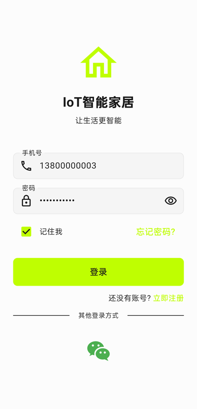 | 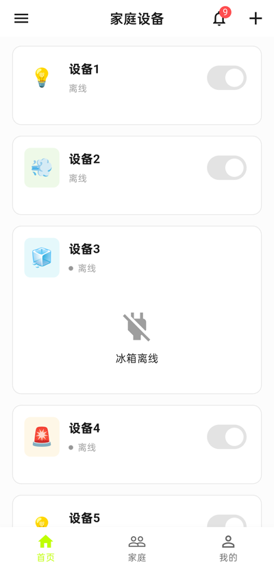 |

| 快捷操作 / 设备列表 | 家庭管理 |
|:---:|:---:|
| 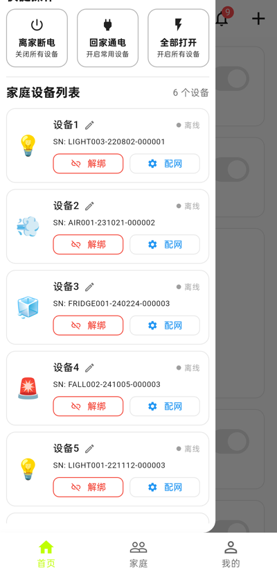 | 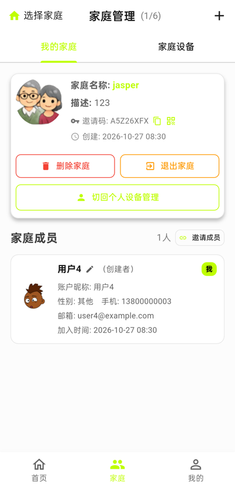 |

### 🏠 家庭与消息

| 家庭设备 | 设备消息 |
|:---:|:---:|
| 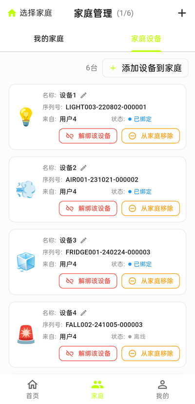 | 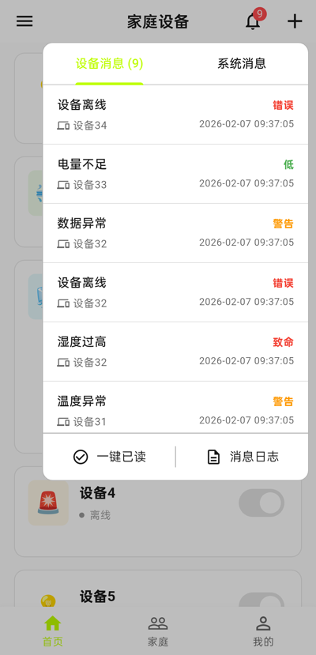 |

| 系统消息 | 每日签到 |
|:---:|:---:|
| 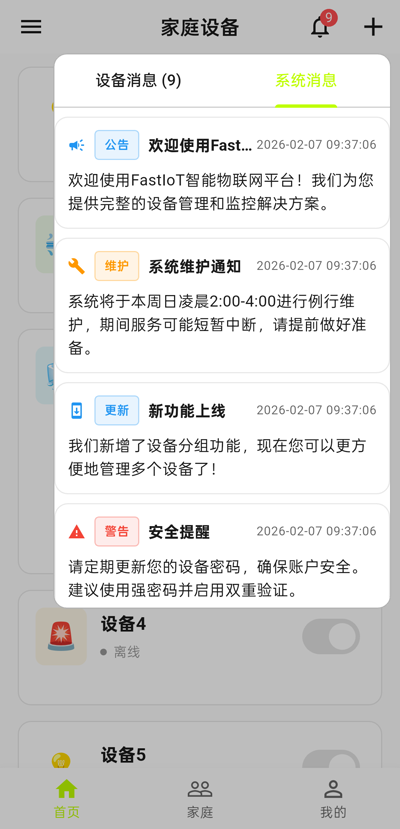 | 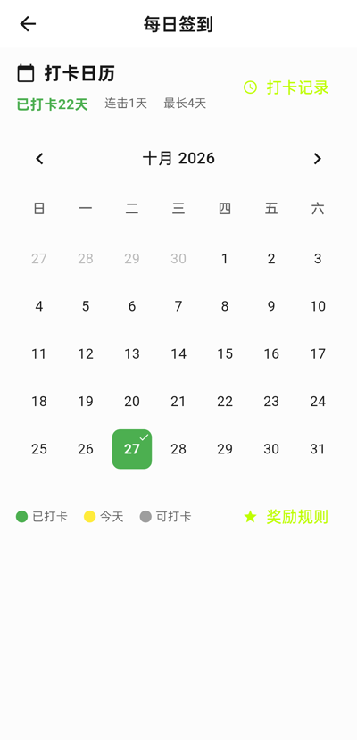 |

### ⚙️ 积分与设置

| 积分记录 | 设置中心 |
|:---:|:---:|
| 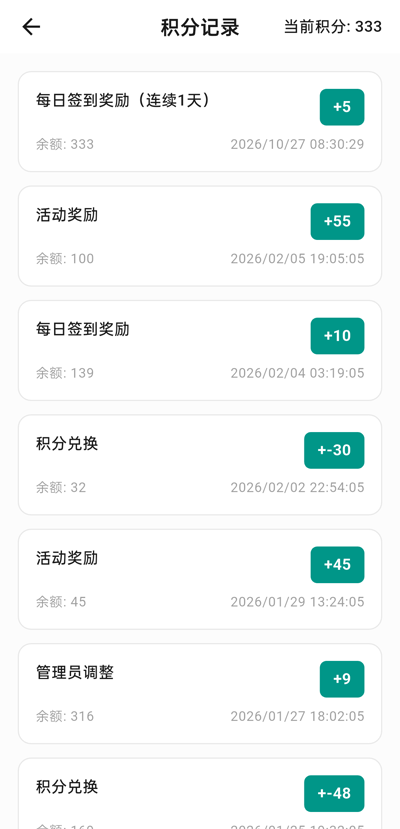 | 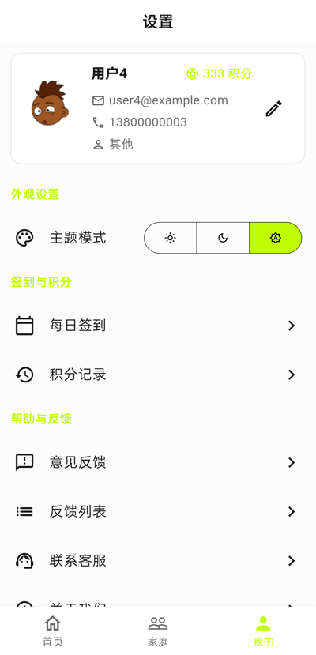 |

| 意见反馈 | 关于我们 |
|:---:|:---:|
| 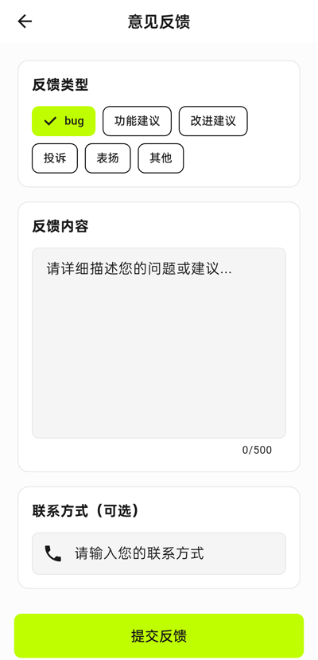 | 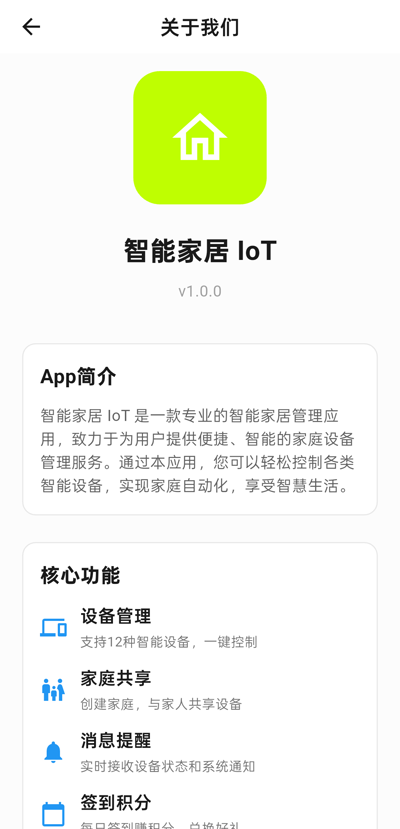 |

### 📱 页面一览

- 🔐 登录页：手机号密码登录、记住密码、微信登录入口
- 🏠 设备首页：按家庭聚合设备卡片，支持开关控制、消息角标
- 🗂 快捷操作：离家断电 / 回家通电 / 全部打开，设备解绑与配网
- 👨‍👩‍👧 家庭管理：家庭信息、邀请码、成员列表、家庭设备管理
- 🔔 消息通知：设备消息与系统消息双 Tab，支持一键已读
- 📅 签到积分：打卡日历、连续签到、积分余额与积分明细
- ⚙️ 设置中心：主题切换、签到入口、意见反馈、关于我们

## ⚙️ 配置说明

### API 配置

编辑 `lib/core/constants/api_constants.dart`：

```dart
// API 基础 URL（移动端需完整地址，真机访问本机服务请用局域网 IP）
static const String baseUrl = 'http://212.129.243.155:8000/api/v1/client';

// MQTT 配置（WebSocket）
static const String mqttBroker = '212.129.243.155';
static const int mqttPort = 8083;
static const bool mqttSecureWebSocket = false;
```

### 真机调试

应用默认直连后端服务，设备需与服务器网络互通：

```bash
# 查看已连接设备
flutter devices

# 指定真机运行
flutter run -d <device-id>
```

## 🎨 主题定制

应用支持三种主题模式：

- ☀️ 浅色模式
- 🌙 深色模式
- 🔄 跟随系统

主题配置文件：

- `lib/app/theme/colors.dart` - 颜色定义
- `lib/app/theme/text_styles.dart` - 文本样式
- `lib/app/theme/app_theme.dart` - 主题配置

## 📊 项目统计

- ✅ 8 个核心功能模块
- ✅ 12 种智能设备卡片
- ✅ 84 个 Dart 文件
- ✅ 23,000+ 行代码
- ✅ 50+ 自定义 Widget
- ✅ 接入真实后端 API 与 MQTT 实时通信

## 🔍 代码质量

- ✅ Flutter Analyze 通过
- ✅ 遵循 Dart 风格指南
- ✅ 完整的空安全支持
- ✅ 类型安全
- ✅ 详细的代码注释

## 🤝 贡献指南

欢迎提交 Issue 和 Pull Request！

**1. Fork 本仓库**

**2. 创建特性分支**

```bash
git checkout -b feature/AmazingFeature
```

**3. 提交更改**

```bash
git commit -m 'Add some AmazingFeature'
```

**4. 推送到分支**

```bash
git push origin feature/AmazingFeature
```

**5. 开启 Pull Request**

## 📄 许可证

本项目采用 MIT 许可证，详见 [LICENSE](LICENSE) 文件。

## 👥 作者

**AI Assistant**

## 🙏 致谢

- Flutter 团队提供的优秀框架
- Riverpod 社区的状态管理方案
- 所有开源贡献者

## 📧 联系方式

- Email：support@iot-app.com
- 官网：www.iot-app.com

---

如果这个项目对你有帮助，请给一个 Star ⭐
